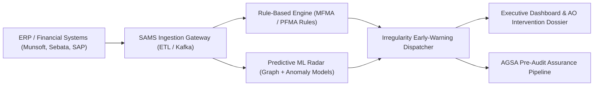
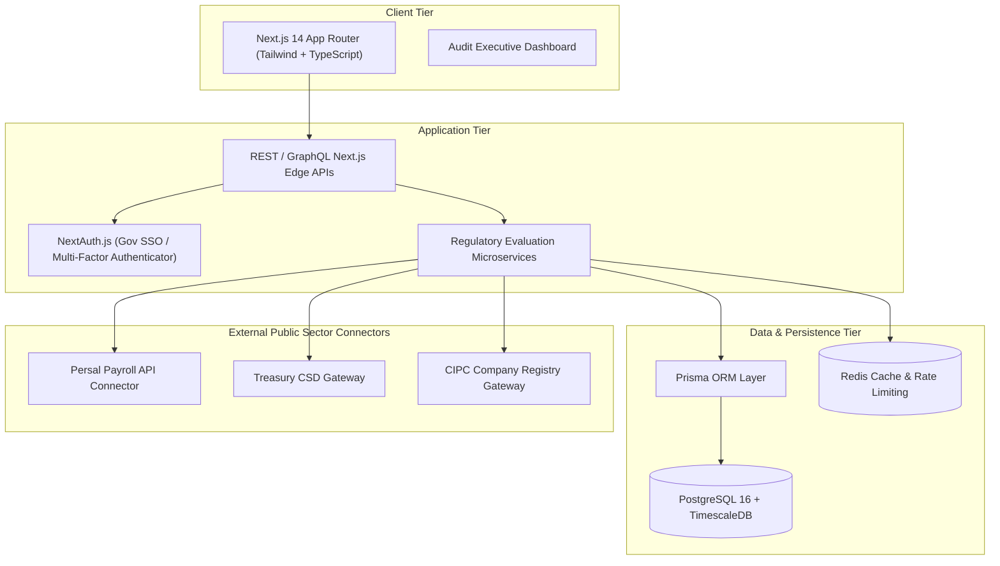

# SAMS System Architecture & Engineering Blueprint

> **Proprietary & Sovereign Intellectual Property of ZAInnovate Technologies (Pty) Ltd**  
> Company Reg: 2025/572318/07 | B-BBEE Level 1 Contributor | East London, Eastern Cape, South Africa  
> *"Engineering South Africa's Digital Backbone"*

---

## 1. Executive Overview

The **Smart Audit Management System (SAMS)** is an enterprise predictive governance platform engineered specifically for the South African public sector (National Departments, Provincial Treasuries, Metropolitan Municipalities, and State-Owned Companies). 

Rather than conducting retrospective forensics months after fiscal year-end, SAMS operates at the **point of voucher origination and tender requisition**. It evaluates procurement actions against statutory rulebooks and trained anomaly detection models, preventing irregular, fruitless, and wasteful expenditure before vouchers transition to disbursement.

---

## 2. Statutory Regulatory Rulebook

SAMS translates complex South African constitutional and legislative frameworks into programmatic evaluation heuristics:

| Legislation / Framework | Section / Circular | Programmatic Implementation |
| :--- | :--- | :--- |
| **Municipal Finance Management Act (MFMA)** | Section 116(3) | Contract variation tracking; automatically flags any amendment exceeding 15% (goods/services) or 20% (construction). |
| **Public Finance Management Act (PFMA)** | Section 38(1)(a)(iii) | Enforces internal controls; flags split orders issued within short temporal windows under R200k/R1M competitive bidding quotas. |
| **National Treasury SCM Regulations** | Regulation 44 | Direct automated cross-referencing between vendor CIPC director IDs and State Persal payroll records. |
| **PPPFA (2022 Regulations)** | Preferential Point System | Evaluates 80/20 and 90/10 scoring matrices, B-BBEE status levels, and specific goal compliance. |
| **Public Audit Act (Act 5 of 2018)** | Material Irregularity (MI) | Intercepts non-compliance causing significant financial loss before Auditor-General Certificate of Debt issuance. |

---

## 3. Predictive Pattern-Recognition Engine

The core predictive capability of SAMS relies on four specialized machine-learning pipelines:

### 3.1 Split-Tender Threshold Interception
Accounting Officers often encounter split purchasing orders engineered to bypass National Treasury competitive threshold requirements (e.g. issuing two R195,000 purchase orders rather than initiating an open R400,000 tender).

- **Algorithm**: Density-Based Spatial Clustering (DBSCAN) over multi-dimensional feature space $(Vendor_{ID}, CostCenter, Timestamp, LedgerCode)$.
- **Detection Window**: Rolling 72-hour and 30-day temporal windows.

### 3.2 Conflict of Interest & Collusion Graph
Constructs a unified bipartite graph combining:
- National Treasury Central Supplier Database (CSD)
- Companies and Intellectual Property Commission (CIPC)
- South African Government Persal Payroll DB
- SARS Tax Compliance PIN Status

Graph link prediction algorithms flag cyclical ownership, common physical addresses, shared directorships, and familial ties between bidding consortia and municipal evaluation committee members.

### 3.3 Price Anomaly & Benchmark Outliers
Maintains an indexed vector store of National Treasury transversal contract baseline prices and regional market goods averages. Any quotation demonstrating markup deviations $> 2\sigma$ from benchmark triggers an automated flag.

---

## 4. Technology Stack & Deployment Topology

---

## 5. Security, Data Sovereignty & POPIA Compliance

1. **Sovereign Hosting Guarantee**: All government procurement records and personnel identity numbers are strictly restricted to local South African cloud data centers (e.g. Johannesburg / Cape Town regions).
2. **Protection of Personal Information Act (POPIA)**: Personnel identity numbers and salary grades ingested during Persal cross-matching are hashed using salted SHA-256 with role-based access masked views.
3. **Immutable Audit Trail**: Every status modification, override, and intervention dossier creation is cryptographically signed and archived in tamper-evident append-only tables.

---

*Copyright © 2026 ZAInnovate Technologies (Pty) Ltd. All rights reserved.*
